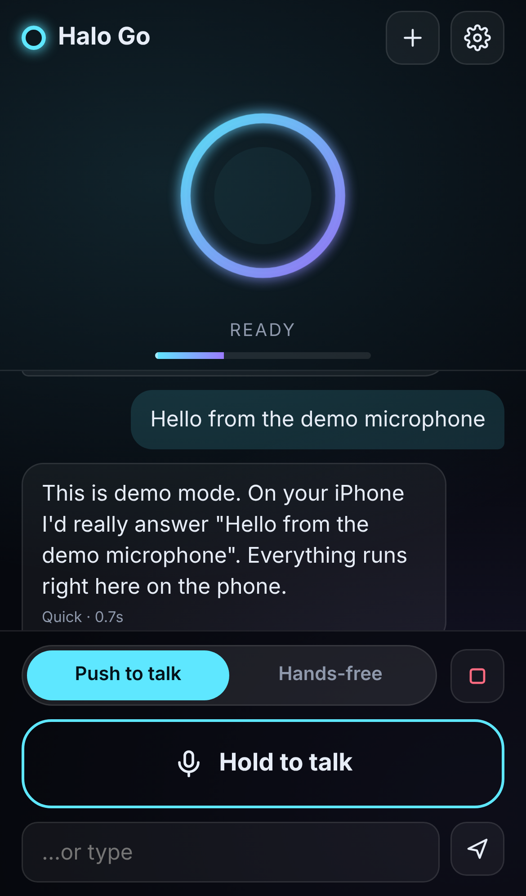

# Halo Go

An offline voice AI that runs **entirely on an iPhone** (made for the iPhone 14). Talk through your headset; Halo Go listens, thinks and talks back with no internet once it's set up.

**Open it:** https://hardwaremack-prog.github.io/halo-go/

- **Brain:** small language models running on the iPhone's GPU in Safari (WebGPU, via WebLLM)
  - Tiny: SmolLM2 360M (~0.4 GB) · Quick: Llama 3.2 1B (~0.9 GB) · Balanced: Gemma 2 2B (~1.6 GB) · Smartest: Llama 3.2 3B (~2.3 GB, may be too big for an iPhone 14)
- **Ears:** Whisper (tiny or base) running on the phone (transformers.js)
- **Voice:** the iPhone's built-in voices
- **Push to talk / Hands-free**, stop button, editable personality, chat kept on the phone

## Set up (once, on Wi-Fi)
1. Needs **iOS 26 or newer** (Settings → General → Software Update).
2. Open **https://hardwaremack-prog.github.io/halo-go/** in **Safari**.
3. Tap **Share → Add to Home Screen**, then open **Halo Go** from the Home Screen.
4. Tap **Download & start** (about 1 GB, keep the screen on). Allow the microphone.

After that it works in airplane mode.

## Updates
When a new version is published here, Halo Go shows **Update ready** at the top. Tap it.

## Tips
- Nicer voices: Settings → Accessibility → Spoken Content → Voices → English → download an *Enhanced* or *Premium* voice, then pick it in Halo Go's settings.
- If Safari closes Halo Go while loading a brain (low memory), it tells you where it stopped and switches to the next smaller brain on the next launch. Closing other apps and tabs first helps.
- `?demo=1` on the URL shows the screens without loading any AI (for testing on a computer).
